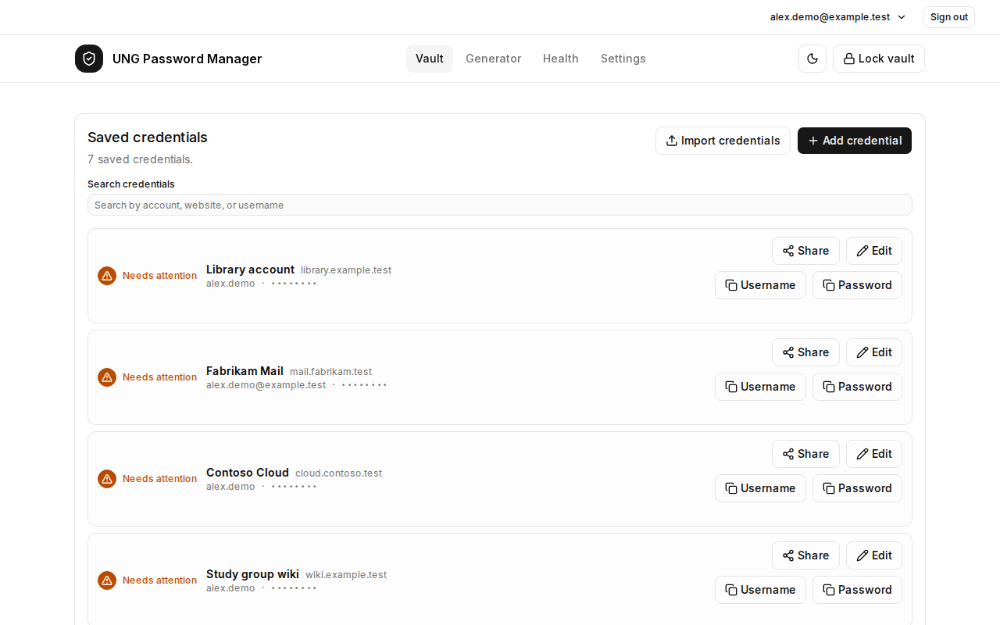

# UNG Password Manager - A zero-knowledge password manager for the web and Chrome

**Live app:** https://passwords.mediasave.llc

UNG Password Manager is a web app and Chrome extension for keeping your passwords in one safe place. Your vault is encrypted in your browser with a key only your password can open, so the server never sees your passwords.

## Features

- **Encrypted Vault**: Save, search and copy logins, encrypted before they leave your browser.
- **Password Generator**: Create random passwords or passphrases with the options you choose.
- **Password Health**: Find weak, reused or old passwords at a glance.
- **Import**: Bring in logins from a CSV or Excel file.
- **Sharing**: Share a login with another user and choose when access ends.
- **Auto-Lock**: The vault locks itself after a few minutes without activity.
- **Device Approval**: New browsers must be approved from a device you already use.
- **Change Password**: Update your password and sign out every other session.
- **Chrome Extension**: Fill saved logins and save new ones from the toolbar.

|  |  |  |
| :---: | :---: | :---: |
| Vault | Password health | Chrome extension |

## Getting Started

### Using the Live App

1. Open https://passwords.mediasave.llc and create an account.
2. To add the extension, go to https://passwords.mediasave.llc/extension and follow the steps there.

### Running Locally

> You need [Bun](https://bun.sh) 1.3.14 or later and MongoDB 7 or 8 ([Docker](https://www.docker.com/) is the easiest way to run it).

1. **Clone the Repository**:
   ```bash
   git clone https://github.com/ung-schoolwork/ung-password-manager.git
   cd ung-password-manager
   ```
2. **Install Dependencies**:
   ```bash
   bun install
   ```
3. **Start MongoDB**:
   ```bash
   docker run --detach --name ung-mongo --publish 127.0.0.1:27017:27017 mongo:8
   ```
4. **Create Your Settings File** (each setting is explained in `.env.example`):
   ```bash
   cp .env.example .env.local
   echo "SHARE_ENCRYPTION_KEY=$(openssl rand -base64 32)" >> .env.local
   ```
5. **Start the App**, then open http://localhost:3000:
   ```bash
   bun dev
   ```

To use the extension locally, uncomment `EXTENSION_ORIGINS` in `.env.local`, restart the app, and install it from http://localhost:3000/extension.

## Tech Stack

- Next.js 16, React 19 and TypeScript
- Tailwind CSS and shadcn/ui
- MongoDB with Mongoose
- Web Crypto API for encryption
- Chrome extension (Manifest V3)
- Bun, Playwright and GitHub Actions for testing and CI

## How It Works

Your browser turns your email and password into two keys. One proves who you are to the server, which only stores a hash of it. The other never leaves your browser and unlocks the key that encrypts your vault with AES-GCM. The server only stores the encrypted vault, so it can't read your passwords. Shared logins are the one exception: the server encrypts them with its own key so the person you share with can open them.

## Testing

```bash
bun run lint
bun run typecheck
bun run test              # unit tests

# integration and browser tests use a throwaway MongoDB on port 27018
docker run --detach --rm --name ung-auth-test --publish 127.0.0.1:27018:27017 mongo:8
export MONGODB_URI=mongodb://127.0.0.1:27018/ung_auth_test
export SHARE_ENCRYPTION_KEY=$(openssl rand -base64 32)
APP_ORIGIN=http://127.0.0.1:3100 bun run test:integration
bunx playwright install chromium   # first time only
bun run test:e2e
```

## Deployment

The live app runs in Docker on a Kubernetes cluster. See [deploy/kubernetes/README.md](deploy/kubernetes/README.md).

## Project Structure

```
app/          pages and API routes
components/   React components
lib/          encryption, accounts, vault and sharing logic
extension/    Chrome extension
tests/        unit, integration and Playwright tests
deploy/       Kubernetes files
```

## Team

- **Chance Caswell**: project lead, encryption and accounts, Chrome extension, deployment
- **Marcos Castellanos**: copy and clipboard, CSV import, sharing
- **Jacob Bridgewater**: password health, risk tags, testing

Built for CSCI 3300 Software Engineering at the University of North Georgia, Fall 2026.
