# UNG Password Manager - A zero-knowledge password manager for the web and Chrome

UNG Password Manager is a web app and Chrome extension for keeping passwords safe without trusting the server with them. Your vault is encrypted in your own browser with a key that only your password can open, so the server stores ciphertext it cannot read. It is built for students and anyone who wants one place to save logins, create strong passwords, spot weak or reused ones, share a login for a limited time, and fill sign-in forms from the browser toolbar. It was built by a three-person team for CSCI 3300 Software Engineering at the University of North Georgia.


## Features

### Vault

- **One password**: A single password signs you in and unlocks your vault, and it never leaves your browser.
- **Saved credentials**: Keep an account label, website, username, password and notes for every login.
- **Add, edit and delete**: Manage entries from dialogs, with a built-in generator one click away.
- **Search**: Find a login by account name, website or username as you type.
- **One-click copy**: Copy a username or password, and the clipboard is cleared again after 15 seconds.
- **Sync between devices**: Changes made on one approved device show up on your others within seconds.
- **Light and dark themes**: Switch with the moon button; the layout also works on phones.

<p>
  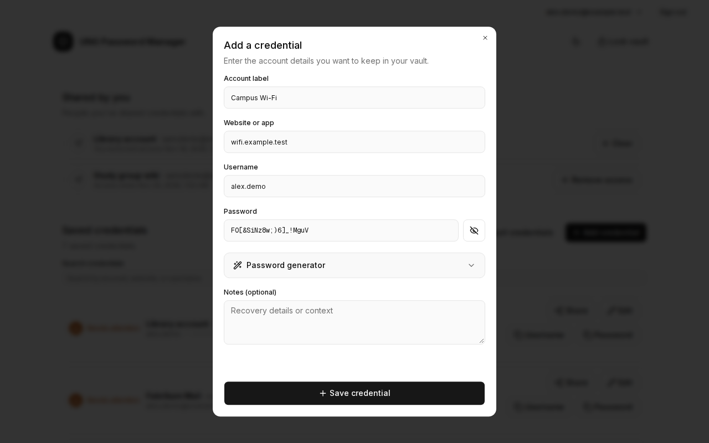
  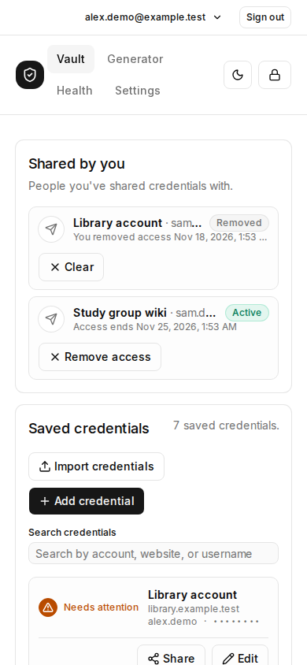
</p>

### Password Generator & Health

- **Password generator**: Create random passwords of 12 to 64 characters and choose which character sets to use.
- **Passphrases**: Generate 4 to 10 random words from the EFF word list, with a choice of separator, capitals and a number.
- **Password health**: See which saved passwords are short, weak, reused across accounts, or unchanged for over 90 days.
- **Risk tags**: Mark accounts as low, medium or high risk so the most important ones are reviewed first.

<p>
  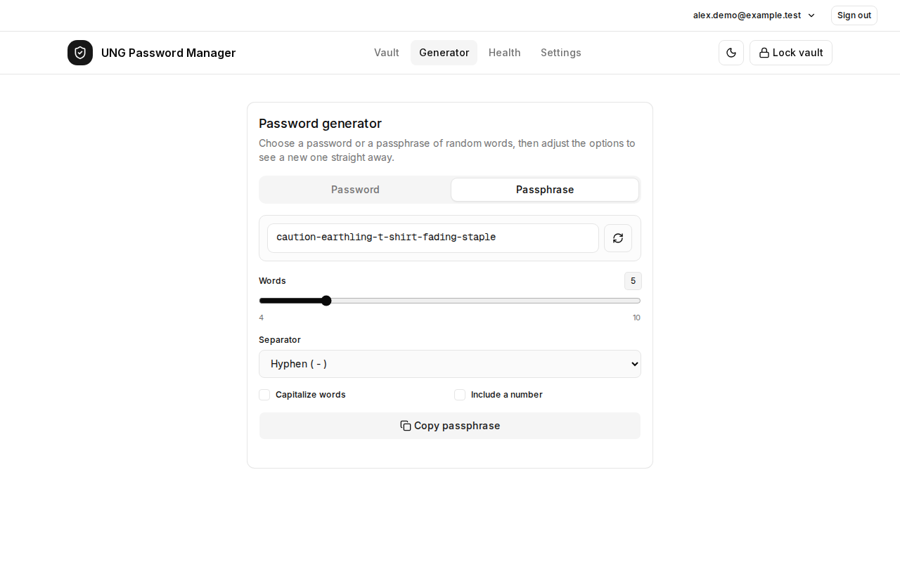
  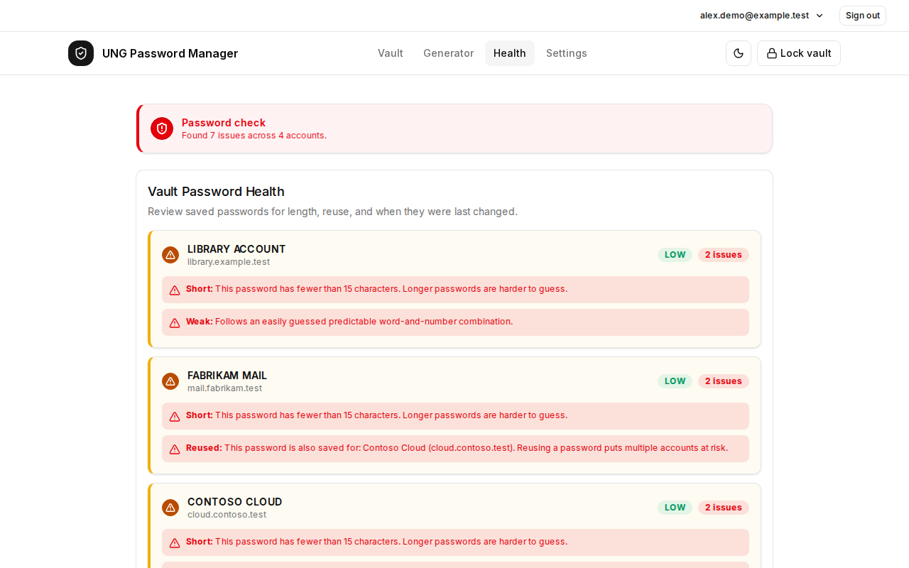
</p>

### Import

- **CSV and Excel import**: Bring logins in from a `.csv` or `.xlsx` export from another password manager or a spreadsheet.
- **Review before importing**: See which rows are ready and which have problems before anything is saved.

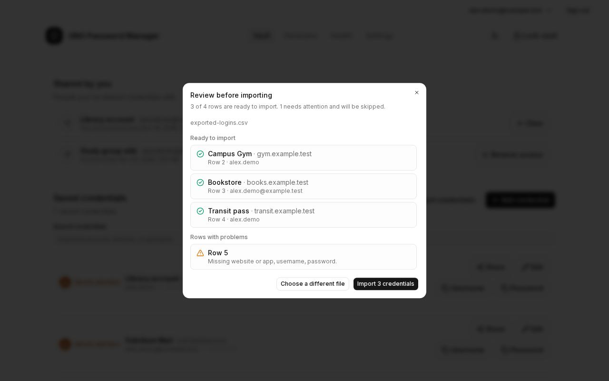

### Sharing

- **Share by email**: Give another account holder access to one credential without sending it by text or email.
- **End dates**: Let access end after 1 hour, 1 day, 7 days, 30 days or on a chosen date.
- **Remove access**: Take access back at any time and see each share's status (active, expired or removed). Deleting a credential ends its shares too.

<p>
  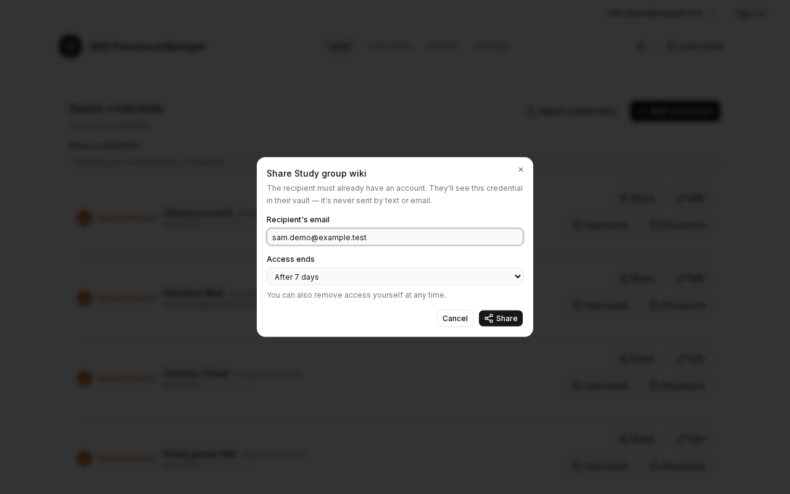
  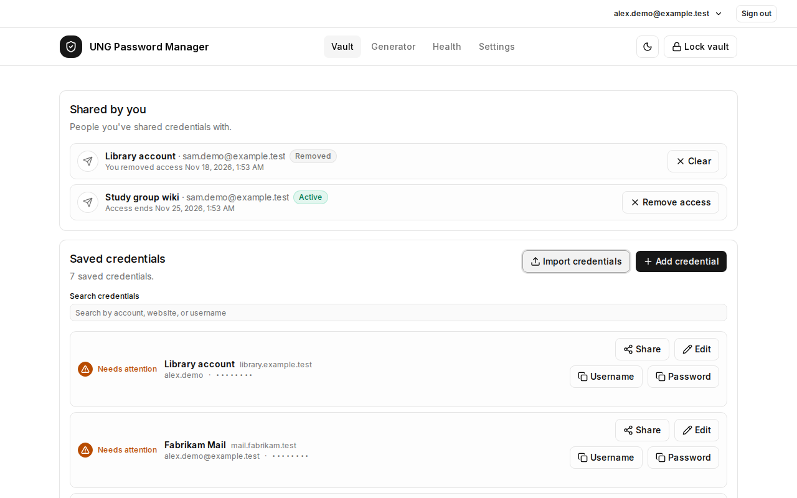
</p>

### Security & Sessions

- **Zero-knowledge encryption**: The vault is encrypted with AES-GCM in the browser; the server only ever stores the encrypted copy.
- **Device approval**: A new browser must be approved with an eight-digit code from a device you already use.
- **Automatic lock**: The vault locks itself after 1 to 60 minutes without activity, with a warning first.
- **Change your password**: Pick a new password without re-encrypting the vault; other sessions are signed out.
- **Rate-limited sign-in**: Repeated sign-in and registration attempts are slowed down to stop password guessing.

<p>
  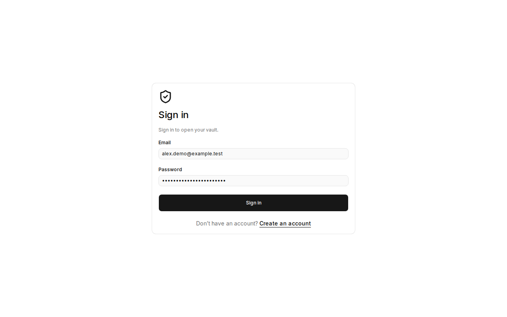
  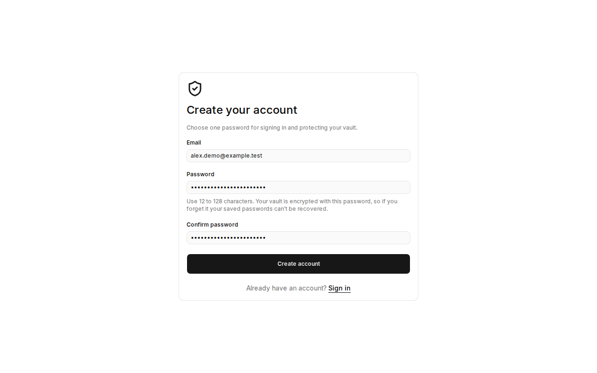
</p>

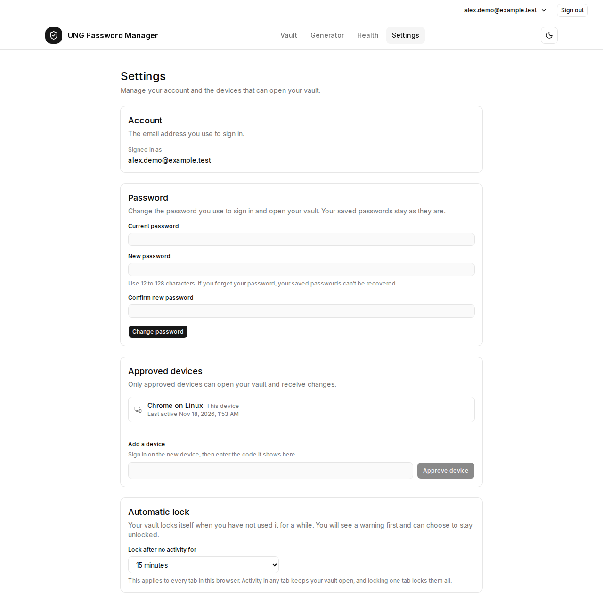

### Browser Extension

- **Toolbar popup**: Sign in or unlock your vault from the Chrome toolbar.
- **Logins for this site**: The popup lists the logins saved for the website in the current tab.
- **Fill**: Fill the username and password into the page's visible sign-in form with one click.
- **Save a login**: Save the details you just typed into a sign-up form straight to your vault.

<p>
  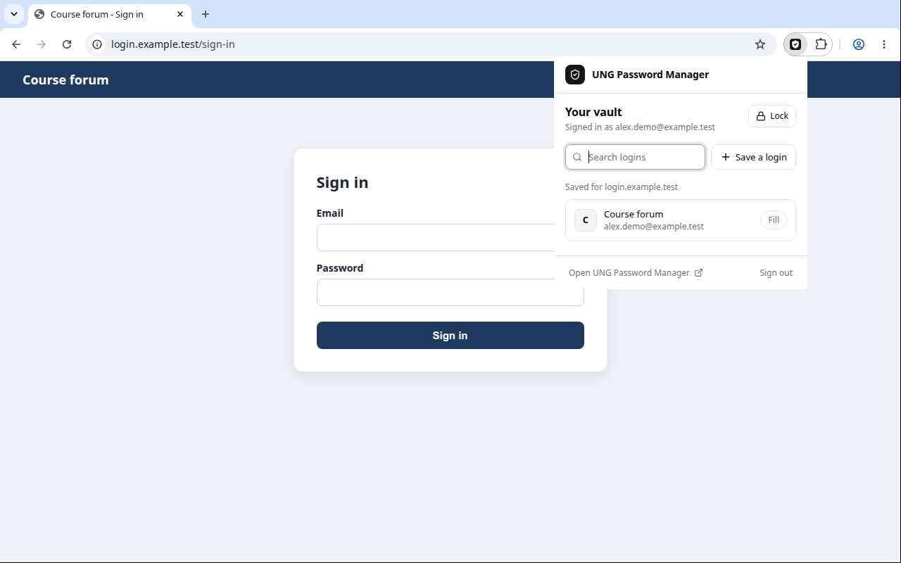
  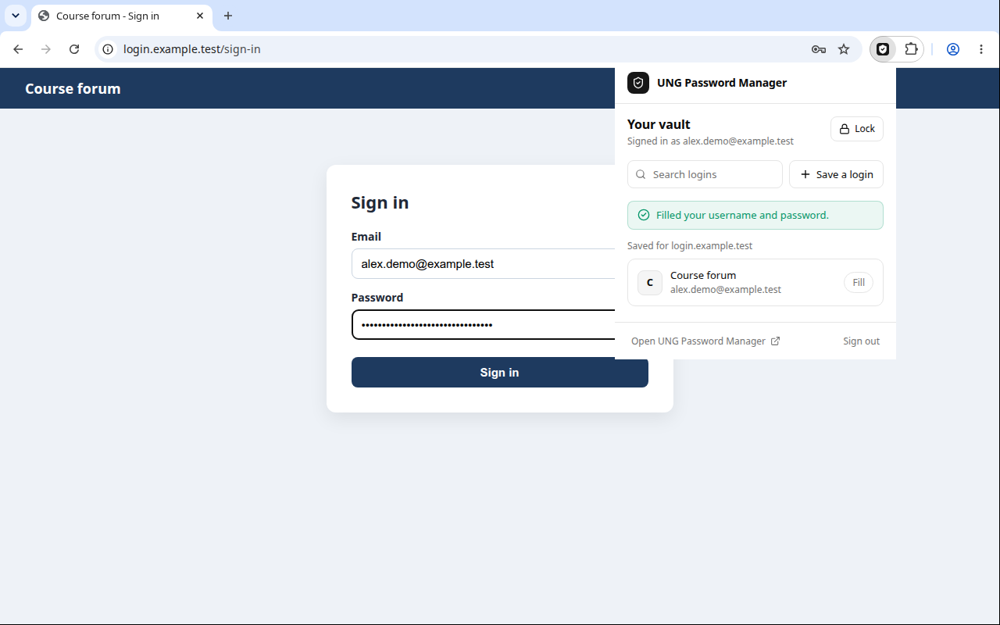
</p>

## Getting Started

> You need [Bun](https://bun.sh) 1.3.14 or later, a MongoDB 7 or 8 database (local with Docker, or MongoDB Atlas), and Google Chrome or Chromium for the extension. [Docker](https://www.docker.com/) is the easiest way to run MongoDB locally, and Node.js 20 or later is needed only for the integration tests.

### Running Locally

1. **Clone the repository**:
   ```bash
   git clone https://github.com/ung-schoolwork/ung-password-manager.git
   cd ung-password-manager
   ```
2. **Install dependencies**:
   ```bash
   bun install
   ```
3. **Start MongoDB** (skip this if you use MongoDB Atlas):
   ```bash
   docker run --detach --name ung-mongo --publish 127.0.0.1:27017:27017 mongo:8
   ```
4. **Create your settings file**, then add a key for credential sharing:
   ```bash
   cp .env.example .env.local
   echo "SHARE_ENCRYPTION_KEY=$(openssl rand -base64 32)" >> .env.local
   ```
   The defaults point at the local database and `http://localhost:3000`. For Atlas, change `MONGODB_URI` in `.env.local`.
5. **Start the app**:
   ```bash
   bun dev
   ```
6. **Open <http://localhost:3000>** and create an account.

To try the production build, run `bun run build` and then `bun run start`. Production rules apply there: `APP_ORIGIN` must be an HTTPS address and `AUTH_TRUSTED_IP_HEADER` must be set, so run it behind an HTTPS reverse proxy as described in [Deployment](#deployment).

### Installing the Extension

The extension is not in the Chrome Web Store, so Chrome loads it from a folder you build.

1. Add this line to `.env.local` and restart the app, so the server accepts requests from the extension:
   ```bash
   EXTENSION_ORIGINS=chrome-extension://ibfocpogcdoolfmhcmnkiojgfpbkfbgj
   ```
2. Build the extension for the address you open the app at. The default is `http://localhost:3000`; use the same host name you type in the address bar (`localhost` and `127.0.0.1` are different sites to Chrome):
   ```bash
   bun run build:extension
   # or, for a deployed app:
   EXTENSION_APP_ORIGIN=https://your-app.example.com bun run build:extension
   ```
3. In Chrome, open `chrome://extensions` and turn on **Developer mode** (top right).
4. Choose **Load unpacked** and select the `extension/dist` folder.
5. Click the puzzle-piece icon in the toolbar, pin **UNG Password Manager**, then click it to sign in.

To give the extension to someone else, zip the `extension/dist` folder; they unzip it and follow steps 3 to 5. After rebuilding, press the reload button on the extension's card in `chrome://extensions`. If the popup says it can't reach UNG Password Manager, check that the app is running at the address the extension was built for. If it says the extension isn't allowed, the server refused the extension's origin (403): add it to `EXTENSION_ORIGINS` and restart the app.

## Tech Stack

| Layer             | Technology                                                                                                        |
| ----------------- | ----------------------------------------------------------------------------------------------------------------- |
| Web app           | Next.js 16 (App Router), React 19, TypeScript                                                                     |
| UI                | Tailwind CSS 4, shadcn/ui on Base UI primitives, lucide icons, next-themes                                        |
| Data fetching     | TanStack Query                                                                                                    |
| Cryptography      | Web Crypto API (PBKDF2-SHA256, HKDF, AES-GCM) in the browser; scrypt and AES-GCM on the server                    |
| Database          | MongoDB through Mongoose                                                                                          |
| Browser extension | Chrome Manifest V3, bundled with `Bun.build`                                                                      |
| Tooling           | Bun (packages, scripts, unit tests), ESLint, Prettier                                                             |
| Testing           | Bun test (unit), Node test runner (integration against MongoDB), Playwright (end-to-end, including the extension) |
| CI                | GitHub Actions: lint, unit, integration, type-check, build, extension build and Playwright on every pull request  |

## Architecture

The server never sees a password or an unencrypted vault. The browser derives every key from the account email and password, encrypts the whole vault, and sends only ciphertext. The server checks who you are, enforces device approval, origin and rate limits, and stores encrypted data. The Chrome extension uses the same encryption code and the same session as the app.

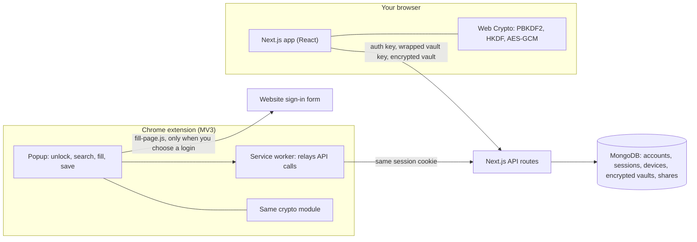

- **Key wrapping.** A random vault key encrypts the vault. That key is itself encrypted ("wrapped") with a key derived from your password, so changing the password only re-wraps one small key.
- **Server role.** API routes under `app/api/` handle accounts, sessions, devices, the encrypted vault and shares. They require the exact app origin on every change, rate-limit sign-in, and store a salted scrypt hash of the auth key rather than anything that can decrypt the vault.
- **Extension design.** The popup holds keys only in memory and forgets them when it closes. Its service worker relays API calls with the browser's own session cookie, and a fill script is injected into the current tab only when you choose a login. More detail is in [Chrome extension](#chrome-extension) below.

### One password: sign-in and vault keys

`lib/vault/crypto.client.ts` derives every key from the account email and password. It uses only the Web Crypto API, so other clients, including the extension, import it unchanged.

```
email + password --PBKDF2-SHA256, 600,000 rounds--> account secret
account secret --HKDF "auth-key"-------------> auth key      sent to the server to sign in
account secret --HKDF "vault-wrapping-key"---> wrapping key  stays in the browser
wrapping key --AES-GCM--> wraps a random vault key
vault key    --AES-GCM--> encrypts the vault
```

The PBKDF2 salt is `ung-password-manager:account:v1:` followed by the email, trimmed and lowercased (`lib/auth/shared.ts`). The two HKDF outputs are independent, so the auth key the server sees cannot recover the wrapping key. Registration creates the random vault key in the browser and sends `{ email, authKey, wrappedVaultKey }`; sign-in sends `{ email, authKey }`. The server stores a salted scrypt hash of the auth key and the wrapped vault key, and neither can decrypt the vault. Changing the password only needs the vault key re-wrapped (`rewrapVaultKey`) and the auth key hash replaced, not the vault re-encrypted.

#### Changing the password

Settings asks for the current password and the new one twice; the new one follows the registration rules. The browser (`lib/auth/password-change.client.ts`):

1. derives the keys for both passwords and loads the wrapped vault key from `/api/vault`, so only an approved device can change the password;
2. unwraps the vault key with the current wrapping key (a wrong current password stops here), re-wraps it with the new one, and checks that the new wrapping opens the same key and decrypts the saved vault before sending anything;
3. sends `{ currentAuthKey, authKey, wrappedVaultKey }` to `POST /api/auth/password`: the sign-in auth key, the registration auth key, and the re-wrapped key. No password or plaintext vault key leaves the browser, and the vault itself is not re-encrypted.

The route requires the exact origin, a live session, and an approved device, and shares the sign-in rate limits (`limited`). It checks the current auth key like sign-in, then replaces the auth key hash, its salt, and the wrapped vault key in one conditional update on the account document (`lib/auth/password-change.server.ts`). The condition is the hash it checked, so two overlapping changes cannot mix one password's hash with the other's wrapped key; the loser gets 409 or 401 and changes nothing.

The same update raises the account's `credentialsVersion`. Every session records the version it signed in with, and `activeSession` rejects sessions from an older version, so all existing sessions, including a sign-in that checked the old password while the change was in progress, stop working in the same write. Old session records are then deleted, and the browser that made the change gets a new session cookie. If that new session cannot be created, the password is still changed and the route returns 503; the browser is signed out and signs in with the new password.

Approved devices stay approved: approval belongs to the browser, not the password, and nothing on a device is wrapped with the password. Their sessions are signed out, so they need the new password to sign in again. Pending credential shares are encrypted with the server's sharing key and are not affected.

#### Locking

After sign-in the browser keeps the wrapping key in memory until this device is approved and the vault opens, then drops it. Locking the vault or reloading the page asks for the same password again.

The vault also locks itself after a stretch without activity: 15 minutes by default, or 1, 5, 30 or 60 minutes as chosen in Settings. The choice is stored per browser in `localStorage`. A warning appears shortly before locking (a minute ahead, or a quarter of the timeout if that is shorter) and offers to stay unlocked. Tabs of the same account share activity and locks over a `BroadcastChannel` (`lib/vault/auto-lock.ts`, `components/vault/auto-lock.tsx`), so activity in any tab keeps the vault open and locking one tab locks them all.

### Sessions and sign-in limits

Login and registration share database-backed global, source, and source/account rate limits; no account-wide lockout is shared between sources. Hashing is limited to two concurrent jobs per process. Add perimeter request limits when deploying; application throttling is not DDoS protection.

Mongoose creates unique account/session indexes and expiration indexes for sessions and rate-limit counters before serving authentication requests. The database account needs permission to create these indexes. Accounts store versioned salted scrypt hashes (`N=32768, r=8, p=3`) of the browser-derived auth key; session records store only token digests. Sessions expire after eight hours. Production cookies are Secure, HttpOnly, SameSite Strict, and use the `__Host-` prefix. Sign-out revokes the current session and removes decrypted vault state. Other open tabs are notified; server revocation is also checked on focus and every 30 seconds.

Sign-out does not send a cookie-clearing header: a delayed logout response must not erase a newer login from another tab. The revoked token may remain in the HttpOnly cookie until it expires or is overwritten by the next login, but the server no longer accepts it.

Account mutations are serialized across tabs with Web Locks where supported. A durable, non-sensitive sign-out generation also invalidates outstanding authentication when Web Locks are unavailable and cross-tab notifications arrive late, even after logout completes. The session created by a successful authentication response invalidated by sign-out is explicitly revoked, so its cookie cannot authorize requests. A non-sensitive pending-sign-out flag keeps the app signed out across reloads if revocation fails; retrying sign-out (or signing in again) completes revocation before further authentication. Normal sign-out preserves encrypted vault data. If browser storage is unavailable, the durable cross-tab sign-out guard and local migration are unavailable; remote vault persistence does not require local storage.

Registration signs the new account in. Duplicate registration returns a generic error, but its status differs from success, so registration can reveal whether an email is already registered. Email verification is not implemented.

### Account vault storage

`/api/vault` persists one encrypted vault per authenticated account. `GET` returns `{ wrappedVaultKey, envelope, revision }`, with `envelope` and `revision` null until the account first saves its vault. `PUT` accepts `{ envelope, expectedRevision }`: null creates a vault only if none exists; a matching revision updates it atomically. A stale revision or concurrent create returns 409 without overwriting the current vault. Ownership comes only from the authenticated session, never from a request-supplied account ID.

Writes require the exact configured origin and a validated version-2 encrypted envelope. Request bodies are capped at 1 MiB, including chunked bodies. Only ciphertext and encryption metadata are stored; these routes do not decrypt vaults. The database needs permission to create the unique account-vault index. Authentication failures return 401, invalid payloads 400, and unavailable storage 503; responses are not cached.

The browser repository remembers the revision loaded with the encrypted envelope and sends it with each save. Decrypted state is committed only after a successful save. Failed saves retain the credential draft and display an error; conflicts require reopening the latest vault before retrying. A fresh browser can sign in and open the same vault as soon as it is an approved device. Vaults saved in browser storage by early versions of the app are ignored and left untouched.

### Approved devices and sync

Each browser is identified by a long-lived, HttpOnly device cookie and registered against the signed-in account. The first device on an account is approved automatically. Every later device shows an eight-digit approval code, valid for ten minutes, and cannot read, write, or poll the vault until an approved device enters that code on the Settings page. Approval attempts are rate-limited per account.

`/api/vault` and `/api/vault/revision` return 403 to unapproved devices. An open vault polls the revision every 15 seconds and when the tab regains focus. When another device has saved a newer revision, the browser fetches it and decrypts it with the vault key held by the unlocked session, and a save built on the replaced data is rejected as a conflict instead of overwriting it.

`/api/devices` lists the account's approved devices and `/api/devices/[id]` removes one after the user confirms on the Settings page. A removed device loses vault access immediately and returns to the approval screen. The current device cannot remove itself.

### Sharing a credential

A credential can be shared with another account by email (`/api/shares`). Sharing is not end-to-end encrypted: the server encrypts the credential at rest with `SHARE_ENCRYPTION_KEY` (`lib/sharing/server.ts`). The team accepted this trade-off to keep sharing simple; recipients do not need the owner's keys.

The recipient does not get a copy. Each time they open a shared credential, `GET /api/shares/[id]` decrypts it for them, and only while the share is active. An owner can give a share an end date (1 hour, 1 day, 7 days, 30 days or a chosen date, up to a year) and can remove access at any time. Once a share expires or is removed the route answers 410 with its status and no credential, and the encrypted credential is deleted from the record. The account label and site stay, encrypted separately, so both people still see which share ended. The rules live in `lib/sharing/status.ts`.

`GET /api/shares` lists `incoming` and `outgoing` shares with their status (`active`, `expired` or `removed`) and never includes a credential. `DELETE /api/shares/[id]` lets the owner revoke a share or the recipient decline it, and either one clear an ended share from their own list; the record is deleted once both have. Shares saved before end dates existed read as active with no end date. A password the recipient already copied cannot be taken back, so the owner is reminded to change it. Shares record the vault id of the credential they copy, and before the browser deletes a credential it ends every share of it (`DELETE /api/shares?credentialId=`); if that fails, nothing is deleted.

### Passphrases

The generator can also build a passphrase of 4 to 10 words (5 by default) drawn with `crypto.getRandomValues` and rejection sampling from the [EFF Large Wordlist](https://www.eff.org/dice) of 7,776 words, about 12.9 bits a word. The list is loaded with a dynamic import, so it is fetched only when a passphrase is generated or the Health checks need it. The Health checks recognise passphrases built from the list and judge them by word count instead of length rules.

The word list in `lib/eff-large-wordlist.ts` is © Electronic Frontier Foundation, used under the [Creative Commons Attribution 3.0 United States](https://creativecommons.org/licenses/by/3.0/us/) licence. Only the dice numbers were removed.

### Chrome extension

`extension/` holds a Manifest V3 Chrome extension with a toolbar popup and a background service worker. The popup signs in, shows the device approval code, and opens the vault: it lists the logins saved for the website in the current tab, searches all of them, fills the one the user chooses into the page, and saves a new login, offering what the user typed into the page's form. It is bundled with `Bun.build`; there is no separate package or framework.

```bash
bun run build:extension                                         # app at http://localhost:3000
EXTENSION_APP_ORIGIN=https://app.example.com bun run build:extension   # deployed app
```

The build writes an unpacked extension to `extension/dist` (ignored by git); see [Installing the Extension](#installing-the-extension) to load it. `EXTENSION_APP_ORIGIN` must be an exact origin and must use HTTPS unless it is a local server; the extension is granted host permission for that origin only.

**Icons.** `extension/icons/icon.svg` is the app's ShieldCheck mark on its primary tile; the 16, 32, 48, and 128 px PNGs the manifest lists are rendered from it (the command is in the SVG) and copied into the build.

**Extension ID.** The build puts the public key from `extension/identity.ts` in the manifest `key`, so Chrome loads the unpacked extension as `chrome-extension://ibfocpogcdoolfmhcmnkiojgfpbkfbgj` on every machine. The build prints this origin. Only the public key is kept in the repository; it fixes the ID but cannot sign a package, which is also why there is no packed `.crx`. Publishing to the Chrome Web Store assigns a different ID, which must then be added to `EXTENSION_ORIGINS`.

**Server access.** State-changing routes still require an allowed `Origin`. Set `EXTENSION_ORIGINS` to a comma-separated list of exact `chrome-extension://<id>` origins to accept them alongside `APP_ORIGIN`. Entries that are not exactly `chrome-extension://` followed by a 32-letter ID are ignored, so a typo never widens access. Every other origin, including other extensions, is still rejected, and production still fails closed without an HTTPS `APP_ORIGIN`. The server adds no CORS headers: Chrome lets an extension read responses from origins in its `host_permissions`, while web pages on other origins still cannot.

**Authentication.** The extension uses the browser's existing session cookie rather than a separate token. Chrome treats requests from an extension page or service worker to an origin in its `host_permissions` as same-site, so the HttpOnly, `SameSite=Strict` session and device cookies are sent and set as they are for the app itself. No credential is stored in extension storage or readable by extension code. The trade-off is that the extension and the app in the same Chrome profile share one session and one device approval: signing out in either signs out both. The Playwright test `tests/e2e/extension.spec.ts` loads the built extension in Chromium and checks both the cookie and the origin rules.

**Requests go through the service worker.** The popup asks the service worker over `chrome.runtime` messaging, and the service worker calls the API. Content scripts must do the same: a request made from a content script carries the visited site's origin and is rejected.

**Signing in and opening the vault.** The extension is not a separate device: it uses the Chrome profile's sign-in and device approval (`extension/src/popup-controller.ts`).

- Signed out: the popup asks for the email and password, derives the keys, and sends `{ email, authKey }` to `/api/auth/login`. The session cookie is the browser's, so the app is signed in too.
- Signed in: the popup takes the email from `/api/auth/session` and asks only for the password, which opens the vault locally; there is no second sign-in.
- Not approved: `POST /api/devices` (the same call the app makes) returns the approval code, which the popup shows and re-checks every 3 seconds. `/api/vault` returns 403 until an approved device enters the code in Settings. A password entered at sign-in is kept as the wrapping key until then, so the vault opens without asking again.
- Open vault: every 5 seconds the popup re-checks the session and `/api/vault/revision`. A 401 or a different account shows sign-in or unlock again, a 403 (this browser was removed in Settings) shows a new approval code, and a new revision is downloaded and decrypted.
- Sign-out in the popup calls `/api/auth/logout`, which signs out the app as well; the app notices on focus or within 30 seconds. Sign-out in the app is noticed by the open popup within 5 seconds, or when it next opens.

The wrapping key, the vault key, the decrypted list, and a login being saved live only in the popup's memory. The service worker relays requests and only handles the auth key and ciphertext; it keeps nothing between messages. Nothing is written to `chrome.storage` (the extension does not request the `storage` permission, so the API is not even available to it), and the manifest requests only `activeTab` and `scripting` besides host access to the app. Closing the popup, locking, signing out, a 401, or a 403 drops the keys and the list, and opening the popup again asks for the password. The popup keeps only the account name, website, and username of each login, plus the encrypted vault; passwords are decrypted with the rest of the vault but not kept.

**Logins for the current website.** Clicking the toolbar button grants `activeTab`, so the popup can read the current tab's address once when it opens; it is not stored. `lib/vault/site-match.ts` compares hosts: a credential's website is free text, read with or without a scheme or path, ignoring `www.` and any port. A tab matches when its host equals the saved host or is a subdomain of it, so a login for `example.com` shows on `accounts.example.com`, but a login for `accounts.example.com` does not show on `example.com`, and `evil-example.com` never matches `example.com`. A saved single label (`com`, `localhost`) or IP address matches only itself. There is no public-suffix list, so a login saved for `co.uk` would match every `co.uk` site. Pages that are not `http` or `https` (`chrome://`, `file:`) get no suggestions. The search box uses `lib/vault/search.ts`, as the app does, over account name, website, and username.

**Filling a login.** Nothing runs on websites until the user chooses a login, or starts saving one, in the popup; there is no content script. Then the popup:

1. Reads the active tab again and checks it with `fillProblem` (`lib/vault/site-match.ts`): the page must be HTTPS, or http on `localhost`, `127.0.0.1`, or `[::1]`, and its host must match the login's website by the rules above. Otherwise it says why and fills nothing.
2. Decrypts the vault with the vault key it holds and keeps only the chosen login's username and password for this one fill. The vault is encrypted as a whole, so it cannot decrypt a single entry.
3. Injects `fill-page.js` into the tab's top frame only (`chrome.scripting.executeScript`, `frameIds: [0]`, in the extension's isolated world), then calls it with the login as arguments. Nothing is written to storage or sent through the service worker.

`fill-page.js` checks the page's address again, so a tab that moved on in the meantime is not filled. It then picks fields with `pickLoginFields` (`extension/src/fill-fields.ts`). Only visible, editable inputs count: hidden, transparent, zero-sized, and off-page fields are skipped. A `current-password` field is preferred, and `new-password` fields (sign-up, password change) are never filled. The username is the field marked `username`/`email` or the text field just before the password. With no password on the page (the first step of a two-step sign-in), only a field marked as an email or username is filled; with no username shown (the second step), only the password. Values are set through the native setter, followed by `input` and `change` events, so framework-managed forms notice. For two steps the popup says to open it again on the next step, which asks for the password again because closing the popup forgets the vault.

The e2e test opens the real toolbar popup with `chrome.action.openPopup()` and reaches it over the DevTools protocol. That does not grant `activeTab`, so the test's "current website" is the app's own origin, which the extension's host permission lets it read and fill; subdomain rules and the HTTPS check are covered by unit tests. The fill tests serve sign-in pages on that origin with `context.route`. They include hidden and off-page trap fields, an embedded frame, and a two-step form.

**Saving a login.** **Save a login** in the open vault reads the current tab once, as filling does, and only in its top frame: `fill-page.js` also defines a reader that picks the page's fields with `pickLoginFields` in its saving mode, which prefers a `new-password` field (sign-up or password change) over the current one. The form is filled with what the user typed there, and the label and website default to the tab's host; when the page has no sign-in fields, or is not a website, the form starts empty. The popup validates the login with `validateCredentialDraft` from `lib/vault/validation.ts`, the same rules as the app, decrypts the vault with the vault key, adds the login, encrypts the whole vault again, and sends only the envelope and the revision it started from (`save-vault`) through the service worker to `PUT /api/vault`. If another device saved first, the server answers 409 without overwriting; the popup loads the newer vault and adds the login to it, up to three times. The typed login lives only in the popup's form until it is encrypted and is cleared when the form closes. Nothing is captured when a form is submitted: that would need a content script on every site, which the extension avoids.

**Shared vault encryption.** `extension/src/vault.ts` re-exports `lib/vault/crypto.client.ts`; the bundler compiles the same module into the extension, so encryption is never copied. A unit test bundles it for the browser and round-trips a vault through it.

## Configuration

Settings are read from environment variables. For local development, copy `.env.example` to `.env.local` (git ignores it). Keep database credentials server-side; never put them in `NEXT_PUBLIC_*` variables.

| Variable                         | Required          | Description                                                                                                                                                                                                                                                                                            |
| -------------------------------- | ----------------- | ------------------------------------------------------------------------------------------------------------------------------------------------------------------------------------------------------------------------------------------------------------------------------------------------------ |
| `MONGODB_URI`                    | Yes               | MongoDB connection string, such as `mongodb://127.0.0.1:27017/ung_password_manager` or an Atlas URI. The database user needs permission to create indexes.                                                                                                                                             |
| `APP_ORIGIN`                     | In production     | The exact origin people open, such as `http://localhost:3000`. If unset, any origin is accepted outside production. Production requires it, and it must be HTTPS.                                                                                                                                      |
| `EXTENSION_ORIGINS`              | For the extension | Comma-separated `chrome-extension://<id>` origins allowed to call the API alongside `APP_ORIGIN`. The repository's unpacked extension is `chrome-extension://ibfocpogcdoolfmhcmnkiojgfpbkfbgj`.                                                                                                        |
| `AUTH_TRUSTED_IP_HEADER`         | In production     | The header your host or reverse proxy sets to the client IP (`x-real-ip` for nginx, Caddy and Vercel; `cf-connecting-ip` behind Cloudflare). Sign-in and registration are refused while it is missing or invalid. Development without it uses a shared loopback source. See [Deployment](#deployment). |
| `SHARE_ENCRYPTION_KEY`           | For sharing       | A 32-byte base64 key that encrypts shared credentials at rest. Generate one with `openssl rand -base64 32`. Sharing fails closed without it.                                                                                                                                                           |
| `NEXT_PUBLIC_CLIPBOARD_CLEAR_MS` | No                | Milliseconds a copied credential stays on the clipboard (default 15000, clamped to 1000-60000). The browser tests set a short value; leave it unset in production.                                                                                                                                     |

The extension build also reads `EXTENSION_APP_ORIGIN` (default `http://localhost:3000`): the app address the extension talks to. It is a build setting, not a server setting.

## Testing

```bash
bun run lint              # ESLint
bun run typecheck         # TypeScript
bun run test              # unit tests (bun test tests/unit)
bun run build             # production build of the app
bun run build:extension   # Chrome extension into extension/dist
```

Integration and browser tests need a real, disposable MongoDB database. The integration tests only run against `ung_auth_test` on port 27018, so they cannot touch a real database by mistake:

```bash
docker run --detach --rm --name ung-auth-test --publish 127.0.0.1:27018:27017 mongo:8
MONGODB_URI=mongodb://127.0.0.1:27018/ung_auth_test APP_ORIGIN=http://127.0.0.1:3100 bun run test:integration
MONGODB_URI=mongodb://127.0.0.1:27018/ung_auth_test bun run test:e2e
docker stop ung-auth-test
```

- **Unit tests** (`tests/unit/`) cover the generator, encryption, health checks, CSV and Excel parsing, site matching, origin rules and more.
- **Integration tests** (`tests/integration/`) call the real API route handlers against MongoDB. They run under Node because Bun cannot load Mongoose's BSON dependency in every version.
- **End-to-end tests** (`tests/e2e/`) use Playwright, which starts its own dev server on `http://127.0.0.1:3100`, in desktop Chromium and a Pixel 7 phone profile. They register real accounts through the real routes, never bypassing authentication. `extension.spec.ts` loads the built extension in Chromium and fills test sign-in pages. Run `bunx playwright install chromium` once first.

GitHub Actions (`.github/workflows/ci.yml`) runs all of these on every pull request and on `main`.

## Deployment

Two settings must be right before anyone can sign in or register on a deployed site:

| Variable                 | Value                                                                                                                                      |
| ------------------------ | ------------------------------------------------------------------------------------------------------------------------------------------ |
| `APP_ORIGIN`             | The exact public origin, such as `https://app.example.com`: HTTPS, no path, no trailing slash. Requests from any other origin are refused. |
| `AUTH_TRUSTED_IP_HEADER` | The header your host or reverse proxy sets to the client IP (table below). Case does not matter.                                           |

Build once with `bun run build`, then start the server with `bun run start` (add `--port` to choose a port) behind the HTTPS proxy. Also set `MONGODB_URI` and `SHARE_ENCRYPTION_KEY`, and `EXTENSION_ORIGINS` if people will use the extension; build the extension with `EXTENSION_APP_ORIGIN` set to the public origin.

Sign-in and registration are rate-limited per client IP, so the server must know which IP each request came from. If `AUTH_TRUSTED_IP_HEADER` is unset, the header is missing from a request, or it does not hold an IP address, those requests are refused (fail closed), never let through without a limit. Users see "Sign-in is temporarily unavailable. Try again later." and the server logs the cause, without header values, at most once every 15 minutes per problem:

```
[auth] Sign-in and registration are refused: requests are missing the "x-real-ip" header named by AUTH_TRUSTED_IP_HEADER. ...
```

**Pick the header for your host.** Only trust a header that the proxy in front of the app sets or overwrites itself; a client can send any header it likes.

| Host                               | `AUTH_TRUSTED_IP_HEADER` | Proxy setup                                                                                                                                                                                                                   |
| ---------------------------------- | ------------------------ | ----------------------------------------------------------------------------------------------------------------------------------------------------------------------------------------------------------------------------- |
| nginx                              | `x-real-ip`              | `proxy_set_header X-Real-IP $remote_addr;` in the `location` that proxies to the app. This replaces any value the client sent.                                                                                                |
| Caddy                              | `x-real-ip`              | `reverse_proxy localhost:3000 { header_up X-Real-IP {client_ip} }`. Without `trusted_proxies`, `{client_ip}` is the connecting address.                                                                                       |
| Cloudflare (proxied DNS or Tunnel) | `cf-connecting-ip`       | Nothing to add; Cloudflare sets it. The origin must accept traffic **only** from Cloudflare (a Tunnel, or a firewall limited to Cloudflare's IP ranges); otherwise anyone can reach the origin directly and forge the header. |
| Vercel                             | `x-real-ip`              | Nothing to add; Vercel sets it to the client IP and replaces any value the client sent.                                                                                                                                       |

When proxies are chained, configure the one that faces the internet. Behind Cloudflare and then nginx, either use `cf-connecting-ip` (with the origin locked to Cloudflare as above) or have nginx restore the client address with `set_real_ip_from <Cloudflare ranges>; real_ip_header CF-Connecting-IP;` and keep `x-real-ip`.

**How values are read.** Single-value headers such as `x-real-ip` and `cf-connecting-ip` must hold exactly one IPv4 or IPv6 address; a port or IPv6 brackets are accepted, and a comma-separated list is refused. `x-forwarded-for` is the one list form accepted: each proxy appends the address it received the request from, so only the **rightmost** entry was written by the proxy in front of the app. The leftmost entry is whatever the client sent and is never used, because trusting it would let anyone pick their own rate-limit bucket. This means `x-forwarded-for` gives the right answer only when exactly one proxy that appends (such as nginx with `$proxy_add_x_forwarded_for`) sits in front of the app; with more hops it yields a proxy's address, so prefer a single-value header. The RFC 7239 `Forwarded` header is not supported.

## Project Structure

```
app/                   routes only - each page.tsx renders one component
  page.tsx             redirects to /vault
  sign-in/, register/  account forms
  vault/               saved credentials, sharing, import
  generate/            the standalone password generator
  health/              password health report
  settings/            account, password change, devices, automatic lock
  api/                 server routes: auth, devices, shares, vault
components/auth/       sign-in, registration and the account menu
components/vault/      vault, credential dialogs, generator, import, sharing
components/settings/   settings cards
components/ui/         vendored shadcn/ui primitives - generated, not written by us
lib/auth/              key derivation helpers, sessions, origin checks, rate limits
lib/devices/           device approval
lib/sharing/           share encryption and status rules
lib/vault/             encryption, validation, storage, sync, health, import, search, site matching
lib/password-generator.ts   password and passphrase generation
lib/eff-large-wordlist.ts   EFF passphrase word list (CC BY 3.0 US)
extension/             Chrome extension (Manifest V3): popup, service worker, build script
tests/unit/            bun tests for lib/ and the extension
tests/integration/     route tests against a real MongoDB
tests/e2e/             Playwright tests that drive a real browser
docs/screenshots/      images used in this README
```

Vault encryption and credential operations run in the browser. `lib/vault/service.client.ts` is the one place that ties the pieces together: it validates a credential, encrypts the whole vault, and hands it to `remote.client.ts` to save through the account. Start there.

## Project Management

- **Scrum in Jira.** Work was planned in a Jira Scrum project (key `SCRUM`) over five sprints: four two-week sprints from September to November 2026 and a shorter final sprint before Thanksgiving. Each sprint ended with a recorded review and demo.
- **Branches and pull requests** are named after their Jira issue, such as `SCRUM-79-extension-ui-polish`, and commit titles carry the key, such as `feat(SCRUM-79): ...`. Every change reaches `main` through a pull request.
- **Continuous integration.** GitHub Actions runs lint, unit, integration, type-check, build, extension build and Playwright tests on every pull request and on `main`, and pull requests are merged once the checks pass.

## Team

| Member             | GitHub                                                               | Main contributions                                                                                                                                                                              |
| ------------------ | -------------------------------------------------------------------- | ----------------------------------------------------------------------------------------------------------------------------------------------------------------------------------------------- |
| Chance Caswell     | [@ChanceCaswell](https://github.com/ChanceCaswell)                   | Project lead; accounts and zero-knowledge encryption, device approval and sync, password generator and passphrases, automatic lock and password change, the Chrome extension, CI and deployment |
| Marcos Castellanos | [@marquitos67x-hue](https://github.com/marquitos67x-hue)             | One-click copy and clipboard clearing, CSV import, credential sharing                                                                                                                           |
| Jacob Bridgewater  | [@jacobabridgewater-boop](https://github.com/jacobabridgewater-boop) | Password health checks, risk tags, Health page, and test coverage                                                                                                                               |

## Course Context

This project was built for **CSCI 3300 Software Engineering** at the **University of North Georgia** in Fall 2026. The course follows Ian Sommerville's _Engineering Software Products_, and the team applied its practices: a product vision, a prioritized product backlog of user stories, Scrum sprints with reviews, layered architecture, and automated testing.

> This is a student project. Do not store real credentials in it.
